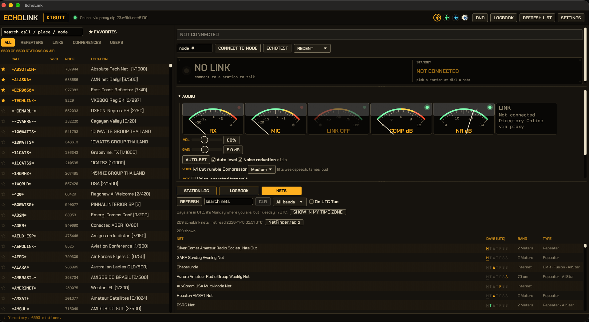

# EchoLink for Mac

A native-feeling **EchoLink** desktop app for macOS, written in Rust. It looks like a piece of
bench gear instead of a web dashboard: a scan-lined readout, a tuning dial, swing-needle
gauges and a big push-to-talk key that glows when you're on the air. Pick one of four themes with
one click.



EchoLink lets licensed amateur radio operators talk to each other, and to repeaters and
conferences, over the internet. This app is a full client: it logs in to the EchoLink
directory, shows who's on, and carries your voice both ways.

## Features

- **Live station list** with search by callsign, place or node number, filters for
  Repeaters, Links, Conferences and Users, and favorites that sort to the top
- **Push-to-talk** by holding the big button, holding **Space**, or holding a **system-wide
  talk key** that works while EchoLink is in the background. A 3-minute transmit limit
  works like a repeater time-out timer, and the key warns you 30 seconds before it trips
- **Readout panel** showing who you're linked to and how long they've been talking, with a
  tuning scale whose marker is placed by node number
- **Swing-needle gauges** for RX, MIC, LINK, COMP and NR (see below). The mic gauge is live
  before you key up
- **Logbook** with QRZ sync, upload, ADIF export, editing and callsign lookups (see below)
- **Nets**: find EchoLink nets, see when they meet in your time zone, and join in one click (see below)
- **Call control**: block list, allow-only list and Do Not Disturb
- **Audio tools** (see below): mic gain, **AUTO-SET**, **Auto level**, **noise reduction**
  and speaker volume
- **DTMF keypad** for repeater and conference control
- **Choose your microphone and speaker** instead of the system default
- **Text chat** and the far station's info text, with a station log underneath
- **Notifications** for incoming calls and chat when the window isn't focused
- **Accepts incoming connections** while you're idle (can be turned off in Settings)
- **ECHOTEST** button for a quick audio check: it records you and plays it back
- **Proxy support** for Starlink, cellular and other connections that can't forward ports
- A **terminal client** (`echolink-tui`) built on the same engine, if you want it

## Logbook

Every connection you make or take is saved on your Mac. Open the **LOGBOOK** tab next to the
station log.

- **Your contacts** newest first, in UTC, with search by callsign or name. Connections of 10
  seconds or more to anything other than a conference or the echo test count as contacts.
- **Worked before**: the **Wkd** column in the station list shows how many times you've worked
  a station, and the station log tells you when you connect ("You've worked K6ABC 3 times before").
- **QRZ sync**: add your QRZ logbook key in **Settings** (QRZ logbook), then press **SYNC FROM
  QRZ** to copy your whole QRZ logbook here. Later syncs fetch only what's new; **FULL RE-SYNC**
  downloads everything again. Sync only reads from QRZ.
- **QRZ upload**: contacts go up to QRZ as they end. A setting also sends anything unsent when you
  quit. QRZ needs a band and mode for every contact, so Settings has defaults (2m, FM); contacts are
  tagged `PROP_MODE=ECH` (EchoLink) so they don't count toward awards. Uploads need a QRZ subscription.
- **ADIF export** saves an `.adi` file in Documents for any logging program.
- **Add, edit, delete**: **+ ADD CONTACT** logs one by hand (untick *EchoLink contact* for an RF
  contact). Click a row for **EDIT** and **DELETE**, or right-click it. Contacts that came from QRZ
  are edited on QRZ, so the details QRZ holds (reports, notes, confirmations) aren't overwritten.
  Deleting one from QRZ is permanent: QRZ has no undo.
- **Callsign lookups**: add your **QRZ account** (username and password) in Settings, then click a
  row or type a callsign in the search box. Their QRZ page opens in a pane beside the logbook: photo,
  details, bio and your history with them. QRZ gives full details to XML subscribers only.

Your key and login stay in your settings file (permissions 600) and go only to QRZ.

## Nets

The **NETS** tab lists EchoLink nets from [NetFinder](https://netfinder.radio), a community-run
directory of amateur radio nets.

- Search by name, filter by band, or tick **On today** to see nets that meet on today's (UTC) day.
  Each row shows the days it meets (today's lit green), the band and the type.
- Click a net for its schedule in UTC, in the net's own time zone and in **your** time zone, plus the
  frequency, organizer, location and website.
- **JOIN NOW** connects to the net's EchoLink node when it's online.

NetFinder has no API, so the app reads its public pages. It identifies itself as EchoLinkMac, reads
nothing until you open the tab, keeps the list on your Mac for a day (REFRESH waits at least ten
minutes), fetches one page per second, and links every net back to its NetFinder page. If NetFinder
changes its layout the tab says so instead of showing wrong data. Net details are kept up to date by
NetFinder's users, so check a net's own page before you go.

## Call control

- **DND** in the top bar refuses every incoming call.
- In **Settings**, a **block list** and an **allow-only list** take calls (`K6ABC`) or prefixes (`W1*`).
- **RECENT**, next to ECHOTEST, reconnects to someone you've talked to lately.
- The Dock icon bounces when someone calls while the window is in the background.

## Audio tools

Under the push-to-talk key, the **AUDIO** section has five swing-needle gauges and a card of link
figures. Drag a gauge onto another to rearrange them (right-click to reset); the order is saved.

- **RX** and **MIC** show your level all the time, so you can set it before going on the air.
  Aim for speech peaks in the **yellow**; the **red** zone means clipping, and the lamp lights
  when the signal hits full scale.
- **LINK** is the health of the connection, from the other station's voice packets: lost packets
  (from gaps in their sequence numbers), jitter, and how recently you heard from them. Needle right
  is better. The card beside it shows the loss, jitter, buffer and audio gaps, time since the last
  packet and whether you are direct or on a proxy. EchoLink has no ping, so round-trip delay isn't shown.
- **COMP** shows how many dB **Auto level** is pulling loud peaks down. **NR** shows how many dB
  of noise the noise reduction is removing. Each dims and reads OFF when its feature is off.
- **GAIN** slider: -20 to +40 dB of software mic gain. macOS doesn't let apps set the input
  volume, so the gain is applied inside the app.
- **AUTO-SET**: talk normally for 5 seconds and the gain is set so your loudest speech
  peaks at about 70%, inside the yellow.
- **Auto level**: keeps adjusting while you talk. It lifts quiet speech, pulls loud speech
  down quickly, holds still when you're silent (so it doesn't boost room noise) and has a
  soft limiter so a peak never reaches the red.
- **Noise reduction**: removes background noise (fans, hum, keyboards) with
  [RNNoise](https://gitlab.xiph.org/xiph/rnnoise), through the pure-Rust
  [`nnnoiseless`](https://github.com/jneem/nnnoiseless) crate. It runs on your Mac and adds
  about 10 ms. It runs before Auto level, so noise is never amplified.
- **VOL**: speaker volume, 0 to 200%.
- **VOICE**: **Cut rumble** is a high-pass filter at 280 Hz that removes desk thumps, wind and hum
  below the voice (on by default). **Compressor** (Off, Light, Medium, Strong) turns loud syllables
  down and lifts weak ones so quiet speech stays readable; the lift fades out toward the noise floor so
  hiss isn't boosted. The order is: gain, rumble filter, noise reduction, compressor, Auto level.
  The COMP gauge shows the combined reduction.
- **VOX**: voice-operated transmit instead of holding the key. It keys when your voice passes the
  **Level** (shown as a mark on the MIC gauge: set it just above your room noise), keeps the last
  200 ms so your first word isn't clipped, and releases after the **Hang** time. It never keys while
  you are hearing someone or for half a second after, and after the 3-minute limit cuts in it waits for a
  real pause before keying again. Holding the key still works as normal.
- **BUF**: the playback buffer, in ms. **Auto** sizes it to the connection (bigger when audio arrives
  unevenly or has run dry, smaller when steady); turn it off to set it yourself. A bigger buffer rides
  out Starlink and hotspot dropouts at the cost of delay. The **gaps** count shows how often the
  audio ran dry while someone was talking: if it keeps rising, raise the buffer. The buffer is the
  delay you add; EchoLink has no ping, so the network's own round-trip time can't be measured.

Everything is saved between launches. The processing order is: mic → gain → noise reduction →
Auto level → 8 kHz → GSM.

### DTMF keypad

Open **DTMF KEYPAD** under the audio controls and click keys (0-9, A-D, *, #) or type a string
of digits and press **SEND**. The tones are sent in the voice stream, and the app keys up for
you and keeps your microphone out of it while they play.

### Talk key and devices

In **Settings**, **Talk key** offers Ctrl+Option+Space, Ctrl+Option+T, F13, F14 or F15. Hold
it to talk from any app. It uses macOS hotkeys, which need no Accessibility permission.
**Microphone** and **Speaker** choose a specific sound device (for example a USB interface or
headset). If a chosen device isn't connected, the app falls back to the system default.

## Themes

Click a swatch in the top bar, just left of **Refresh list**. The change is instant and is
remembered between launches.

| Theme | Look |
|---|---|
| **Amber** (default) | Warm black chassis with amber phosphor |
| **Phosphor** | Green-screen terminal |
| **Cobalt** | Night-watch navy with an ice-cyan display |
| **Paper** | Daylight: logbook cream with fountain-pen ink |

The choice is saved in `~/Library/Application Support/echolink-tui/gui-theme`.

## Requirements

- A Mac with macOS and a microphone and speaker (the system default devices unless you pick others in Settings)
- A callsign validated for EchoLink at <https://secure.echolink.org/validation/>.
  Use your personal callsign (e.g. `N0CALL`), not a `-R`/`-L` node callsign that a repeater
  or link is already logged in with.
- [Homebrew](https://brew.sh) to install the build tools
- Either UDP ports **5198–5199** reachable from the internet (forward them to this Mac
  on your router), or an **EchoLink proxy** (see below). Carrier-grade NAT connections can't
  forward ports, so they need the proxy.

## Install

### Option 1: download the app (Apple Silicon)

Download `EchoLink-<version>-arm64.dmg` from the
[latest release](https://github.com/KI6UIT/echolink-mac/releases/latest), open it and drag
**EchoLink** to **Applications**. Nothing else needs installing (libgsm is inside the app).

The app is ad-hoc signed, not notarized, so macOS blocks it the first time. Right-click it and
choose **Open**, then **Open** again, or go to **System Settings, Privacy & Security** and click
**Open Anyway**. You only do this once. Check the download against `SHA256SUMS.txt` on the
release page if you like:

```bash
shasum -a 256 ~/Downloads/EchoLink-*.dmg
```

### Option 2: build from source

```bash
brew install rustup libgsm
export PATH="/opt/homebrew/opt/rustup/bin:$PATH" && rustup default stable
git clone https://github.com/KI6UIT/echolink-mac
cd echolink-mac
./install.sh
```

This builds `~/Applications/EchoLink.app` (double-click it, or find it in Launchpad) and puts
`echolink-tui` in `~/.local/bin`. To skip the desktop app and build only the terminal client,
run `./install.sh --tui-only`.

The first time you open the app it asks for your callsign, password, name, location and
connection type. Allow microphone access when macOS asks.

Because the app is ad-hoc signed and not notarized, macOS may block it the first time. Either
right-click it and choose **Open**, or run:

```bash
xattr -dr com.apple.quarantine ~/Applications/EchoLink.app
```

To update, pull and run `./install.sh` again. Quit the app first.

### Building the DMG yourself

`packaging/build-dmg.sh` builds a self-contained `EchoLink.app` for your Mac's architecture,
copies libgsm into the bundle, signs it and writes `dist/EchoLink-<version>-<arch>.dmg`. Set
`SIGN_IDENTITY` (and `NOTARY_PROFILE`) to sign with a Developer ID and notarize; the comments at
the top of the script explain how.

## Using the app

- Double-click a station, type a node number and press Enter, or press **ECHOTEST**.
- Hold the **Push to talk** key, or hold **Space** while no text box is selected, or hold your
  talk key from Settings.
- Run **AUTO-SET** once, then say a few words on ECHOTEST to check your levels.
- Click ☆ to make a station a favorite. **★ Favorites** shows only those.
- Drag the **dividers** between the readout, the audio section and the logbook to give each the room
  you want; they remember their place. The line between the station list and this column moves too.
- **Settings** changes your details or connection. The app restarts itself to apply them.
- Closing the window disconnects and logs you off the directory.

Try ECHOTEST (node 9999) first. It plays back what you say.

### Where things are saved

| What | Where |
|---|---|
| Settings, including favorites, audio and devices | `~/Library/Application Support/echolink-tui/config.toml` (permissions 600) |
| Theme | `~/Library/Application Support/echolink-tui/gui-theme` |
| Divider positions and gauge order | `~/Library/Application Support/echolink-tui/gui-layout` |
| Net list (cached for a day) | `~/Library/Application Support/echolink-tui/nets-cache.json` |
| Your contacts | `~/Library/Application Support/echolink-tui/contacts.jsonl` |
| Copy of your QRZ logbook | `~/Library/Application Support/echolink-tui/qrz-logbook.jsonl` |
| Activity log | `~/Library/Application Support/echolink-tui/activity.log` |

Your password is stored in the settings file. You can also leave it out of the file and set
`ECHOLINK_PASSWORD` in the environment.

### Proxy

If you're behind carrier-grade NAT, choose a proxy in Settings, or set it in `config.toml`:

```toml
proxy = "auto"                 # pick a Ready public proxy, nearest first
# proxy = "elp-51.w3kit.net"   # or a specific one (port 8100 unless you add :port)
# proxy_password = "secret"    # only for a private proxy; public ones use PUBLIC
```

The app then makes one outgoing TCP connection (port 8100) to the proxy, which logs in to the
directory and exchanges station traffic from its own public IP. Other stations see you at the
proxy's address. If the proxy drops, another is picked and you're logged in again within about
10 seconds. Public proxies are listed at <https://www.echolink.org/proxylist.jsp>.

### When a call doesn't connect

Everything the app does (directory logins, each connection packet, audio and chat) is written
to the activity log above. Watch it with:

```bash
tail -f ~/Library/Application\ Support/echolink-tui/activity.log
```

Nodes accept a connection only from an IP that's logged in to the EchoLink directory, and some
refresh their copy of the directory only every few minutes. If a node doesn't answer right
after you start the app, wait a minute and try again. If nothing ever connects, check the
UDP 5198–5199 forwarding, or use a proxy.

## Terminal client

```bash
echolink-tui setup        # enter your station details (shares the app's settings file)
echolink-tui              # full-screen client
echolink-tui list ala     # log in and print matching stations, e.g. everything in Alabama
```

| Key | Action |
|---|---|
| ↑ ↓ / j k, PgUp PgDn, g G | Move through the station list |
| Tab / Shift-Tab | All · Repeaters · Links · Conferences · Users |
| `/` | Search callsign, location or node number (Esc clears) |
| Enter | Connect to the selected station |
| `n` | Connect by node number |
| Space | Talk (hold, or tap on and off) |
| `c` | Send a chat message |
| `d` | Disconnect |
| `r` | Reload the station list |
| `q` / Ctrl-C | Disconnect, log off and quit |

Space is a hold in terminals that report key releases (Ghostty, Kitty, Alacritty, foot) and a
tap on, then off, elsewhere.

## Customizing the look

The whole look lives in `src/bin/echolink-gui/theme.rs`. Colors come from a `Palette` struct,
so a new theme is one more entry in `PALETTES`. The swatch picker, the saved choice and every
widget pick it up automatically. The fonts are [Chakra Petch](https://fonts.google.com/specimen/Chakra+Petch)
for labels and [DM Mono](https://fonts.google.com/specimen/DM+Mono) for data, both embedded
from `assets/fonts/` under the SIL Open Font License.

## How it works

| Part | Protocol |
|---|---|
| Directory | TCP 5200 to `servers.echolink.org` and backups: log in, refresh every 5 min, fetch the list |
| Control | UDP 5199, RTCP SDES packets as hello and 10 s keepalive, BYE to hang up |
| Audio | UDP 5198, RTP with four GSM 06.10 frames (80 ms) per packet. `oNDATA` text packets carry info and chat |
| Proxy | TCP 8100: MD5 challenge login, then framed blocks carrying the directory TCP stream and both UDP ports |

The protocol details, including the proxy, follow [SvxLink's echolib](https://github.com/sm0svx/svxlink/tree/master/src/echolib)
and AllStarLink's [chan_echolink](https://github.com/AllStarLink/app_rpt/blob/master/channels/chan_echolink.c).
The desktop app is built with [egui](https://github.com/emilk/egui).

## Tests

```bash
cargo test    # packet formats, directory parsing, GSM codec, resampler, proxy framing,
              # mic gain, auto-set, auto level, noise reduction, DTMF tones, the contact log,
              # ADIF, QRZ upload/sync/lookup (against a stand-in server) and link measurement
ELPROXY_CALL=N0CALL cargo test live -- --ignored   # tunnel to the directory through a real public proxy
```

`tests/run-peer-test.sh` runs a full call against a simulated station but needs Linux network
namespaces, so it isn't available on macOS.

## Linux

It also builds on Linux (needs `gsm` and `alsa-lib`, e.g. `sudo pacman -S --needed gsm alsa-lib`).
`./install.sh` installs both programs under `~/.local` with an app-menu entry, and settings live
in `~/.config/echolink-tui/`.

## License

GPL-2.0-or-later, the same as SvxLink, whose protocol code this follows. See [LICENSE](LICENSE).

EchoLink® is a registered trademark of Synergenix Interactive, LLC. This project isn't
affiliated with or endorsed by it.
